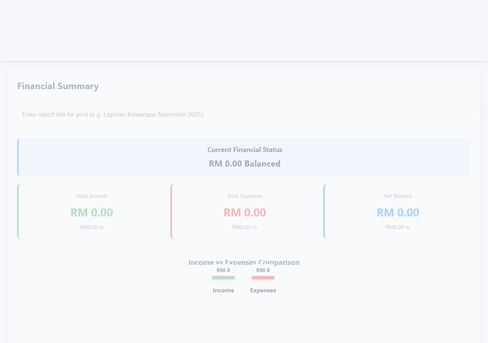
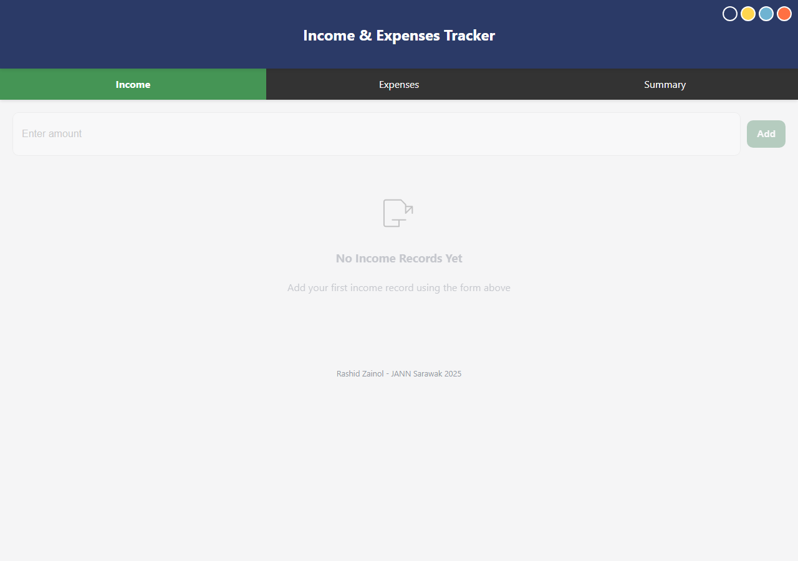
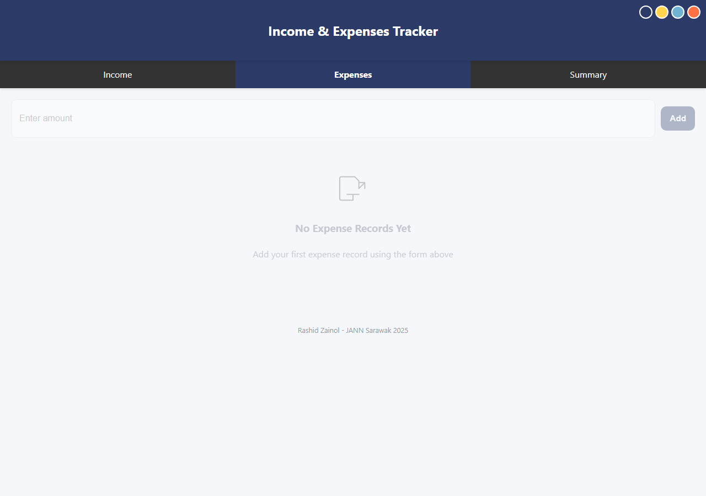

# Statement of Comprehensive Income Casting (SOCI Casting)

A browser-based income & expense casting tool with live totals, visual comparison, and professional reports. Works entirely offline.

## ✨ Features

- **Income & Expense Tracking**: Add, edit, and delete entries with ease.
- **Real-time Calculations**: Automatic totals, net balance, and million-format display.
- **Visual Comparison Chart**: Animated income vs expenses bars.
- **Balance Indicator**: Clear Surplus / Deficit / Balanced status.
- **Themes**: Professional, Happy, Calm, Energetic.
- **Bilingual UI**: English and Bahasa Malaysia.
- **Print-ready Reports**: Custom report title and clean print layout.
- **Offline-capable**: No server, no dependencies.

## 📸 Screenshots

### Income

### Expenses

### Summary

## 🚀 Quick Start

1. Download `Statement Of Comprehensive Income Casting.html` (or the release ZIP).
2. Open it in any modern browser.
3. Start adding income and expenses.

## 📊 Usage

- **Add**: Enter amount and click Add or press Enter.
- **Edit**: Click ✏️ on a row.
- **Delete**: Click 🗑️ and confirm.
- **Summary**: View totals, net balance, and comparison chart.
- **Print**: Set a report title, then click Print Report.

## 🛠️ Tech Stack

- Pure HTML, CSS, JavaScript (single file).
- No external dependencies; offline-first.

## 📄 License

MIT License. See [LICENSE](LICENSE).

---

**Developer**: Rashid Zainol - JANN Sarawak 2025